<p align="center">
  
</p>

<h1 align="center">Caravan</h1>

<p align="center"><b>Your own e-book and comic library, served from home, with a reader that turns real pages.</b></p>

<p align="center">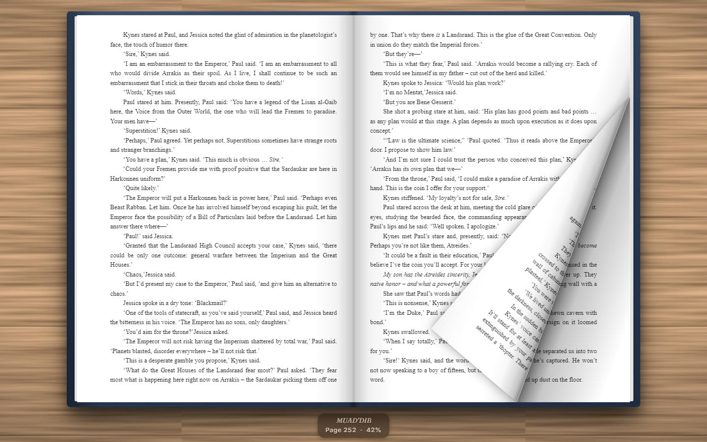</p>

<p align="center"><i>Dune, open on the desk mid page-turn. The back of the turning leaf is the real next page.</i></p>

Caravan is a self-hosted server for your e-books and comics, in the spirit of Jellyfin. Point it at the folders where your books already live, and it builds a library: covers, series, authors, collections and reading progress that follows you between devices. Read in any web browser, in **[Satchel](https://github.com/GetHorizontal63/satchel)** (the Android app), in the desktop app, or in any OPDS reader such as KOReader or Moon+ Reader.

It runs in Docker (TrueNAS included) or directly on Windows. Book details and cover art are matched by ISBN, falling back to a title and author search, using Open Library and Google Books.

Project home: **https://github.com/GetHorizontal63/caravan** · Android app: **https://github.com/GetHorizontal63/satchel**

---

## Contents

| | |
|---|---|
| [Quick start](#quick-start) | Get the server running (TrueNAS, Docker or Windows) |
| [What you need](#what-you-need) | Your books, and the example library used in this guide |
| [The screen at a glance](#screen) | What every button on the home screen does |
| [From folder to first page](#steps) | Nine steps, with pictures, using Dune and A Court of Thorns and Roses |
| [My Shelf](#my-shelf) | Your private books, and sharing them with people you choose |
| [Satchel, the Android app](#satchel) | Connecting your phone, and reading offline |
| [Troubleshooting](#troubleshooting) | Fixes for common problems, step by step |
| [Reference](#reference) | Formats, file naming rules, settings, how it works |

---

<a id="quick-start"></a>

## Quick start

| 1. Start the server | 2. Open the page | 3. Follow the wizard |
|---|---|---|
| On **TrueNAS**, **Docker** or **Windows**; see the three options below. | In any browser, go to:<br>**http://&lt;server-address&gt;:8420** | Create the admin account, then add a library pointing at your books ([step 2](#step-2)). |

### Option A: TrueNAS SCALE (24.10 or newer)

Go to **Apps → Discover Apps → ⋮ → Install via YAML**, name the app `caravan`, paste this, and change the two `/mnt/…` paths to your own datasets:

```yaml
services:
  caravan:
    build:
      context: https://github.com/GetHorizontal63/caravan.git#main
      # args:
      #   INSTALL_CALIBRE: "true"   # adds ~1 GB; enables DOCX / RTF / ODT / LIT / PDB / LRF
    image: caravan:latest
    pull_policy: build
    restart: unless-stopped
    user: "568:568"                  # TrueNAS "apps" user; see the note below
    ports:
      - "8420:8420"
    environment:
      TZ: America/New_York           # your timezone
    volumes:
      - /mnt/POOL/apps/caravan:/config   # database, cover cache, converted files
      - /mnt/POOL/Books:/books           # your books
```

> [!IMPORTANT]
> The `apps` user (568) must be able to **write** to the config folder, and to **read** the books folder. To let Caravan create `covers/` and `spines/` folders next to your books and accept uploads, it needs **write** access there too. Set this in **Datasets → Edit Permissions**, or delete the `user:` line to run as root.

**To update:** run your usual push to GitHub, then in TrueNAS open **Apps → caravan → Edit** and press **Save**. TrueNAS rebuilds the image from GitHub. Don't start the same app a second time from the shell with `docker compose`; see [problem 2](#ts-name).

### Option B: Docker Compose

Edit the books path in `docker-compose.yml`, then:

```bash
docker compose up -d --build
```

| Volume | Holds |
|---|---|
| `/config` | the SQLite database, cover and spine cache, converted-file cache |
| `/books` (any path) | your library folders; add `:ro` to make them read-only (this turns off uploads and the `covers/` / `spines/` folders) |

For the extra Calibre formats: `docker compose build --build-arg INSTALL_CALIBRE=true` (adds about 1 GB).

### Option C: Windows

Requires [Node.js 24 or newer](https://nodejs.org).

```powershell
npm run install:all
npm run build          # builds the web client into web\dist
npm start              # http://localhost:8420, data in .\data
```

To start Caravan with Windows, run `scripts\windows\install-service.ps1` from an elevated PowerShell. It registers a startup task and opens the firewall port.

> [!NOTE]
> Build from a local drive. npm workspaces, TypeScript and Vite's bundler all fail on network paths such as `\\server\share\…`. Running the built server from a network path is fine.

---

<a id="what-you-need"></a>

## What you need

- **The server running** (see [Quick start](#quick-start)), and an up-to-date browser: Chrome, Edge, Firefox or Safari.
- **Your books, in folders.** Any layout works: one folder per book, per series or per author, or everything in one folder. Caravan reads EPUB, Kobo EPUB, MOBI, AZW, AZW3, FB2, PDF, CBZ, CBR, TXT, Markdown and HTML out of the box (full list in the [Reference](#formats)). Books must be DRM-free.
- **Optional: your own cover and spine pictures.** Put them in `covers/` and `spines/` folders, or next to the book as `cover.jpg` and `spine.png` ([step 3](#step-3)).

**The example library in this guide:** the six original Dune novels and the five A Court of Thorns and Roses books. These are the settings used for every picture:

| Step | Setting | Value |
|---|---|---|
| 1. Account | Server name / username | **Caravan** / **reader** |
| 2. Library | Name / content type / folder | **Books** / **Books** / **`/books`** |
| | Fetch metadata online | **Off** for these pictures (the files already carry good details); leave it **on** for a real library |
| 3. Files | Dune | one folder, with **`covers/`** and **`spines/`** subfolders named after each book |
| | A Court of Thorns and Roses | one folder per book, with **`cover.jpg`** and **`spine.png`** beside the book |
| 5. Series | Dune | books **1–6** |
| | A Court of Thorns and Roses | **1, 2, 3, 3.5** (A Court of Frost and Starlight), **4** |
| 6. Collections | Two collections | **Desert planet re-read** and **Summer by the water** |
| 8. Reading | Display | **Light** theme, **Book on a desk**, **Walnut** desk, **Page curl** |
| 9. Appearance | Palette / mode | **Terracotta & Amber** / **Dark** (the web app's default) |

---

<a id="screen"></a>

## The screen at a glance

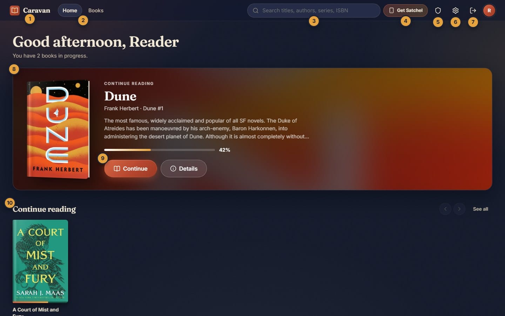

| # | What it is | What it does |
|:-:|---|---|
| 1 | **Caravan** | Back to Home from anywhere. The logo follows your colour palette. |
| 2 | **Navigation** | **Home**, one tab for each library (here, **Books**), and **My Shelf**. On a phone these move to a bar at the bottom: Home, Library, My Shelf, Search and Settings. |
| 3 | **Search** | Finds titles, authors, series, tags and ISBNs across every library. Press Enter. |
| 4 | **Get Satchel** | Opens the latest Android app download (web only). |
| 5 | **Administration** | Admins only: dashboard, libraries, users, metadata and server settings. |
| 6 | **Settings** | Your appearance (colours, light or dark) and reading defaults. |
| 7 | **Sign out** | Signs this device out. The letter beside it is your account. |
| 8 | **Featured book** | The book you're reading, or the newest arrival if you aren't reading anything. |
| 9 | **Continue** | Opens the reader exactly where you left off, on any device. |
| 10 | **Shelves** | Continue reading, Recently added, Favorites, and one row per library. **See all** opens the full list. |

---

<a id="steps"></a>

## From folder to first page

### Step 1: Create the admin account

<table><tr>
<td width="420">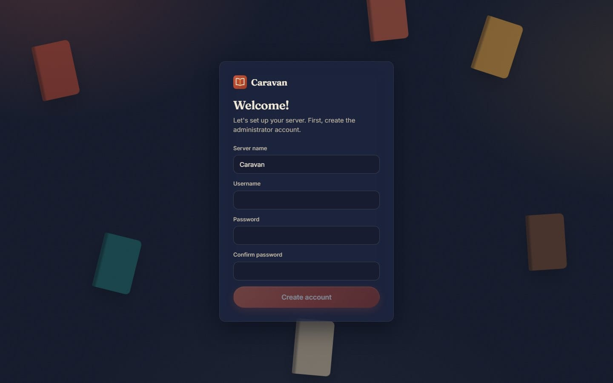</td>
<td>

The first time you open Caravan, it asks for an administrator.

1. **Server name:** leave it as **Caravan**, or name it after your home. It shows in the browser tab and in OPDS apps.
2. **Username** and **Password** (twice).
3. Press **Create account**. You're signed in straight away.

Other people get their own accounts later, under **Administration → Users**. Everyone has their own progress, favourites, highlights and collections.

</td></tr></table>

---

<a id="step-2"></a>

### Step 2: Add the library

<table><tr>
<td width="420">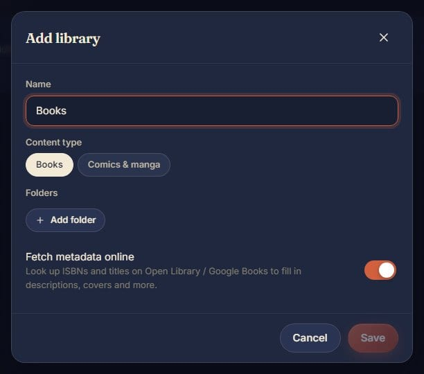</td>
<td>

1. Open **Administration** (5) → **Libraries** → **Add library**.
2. **Name:** **Books**.
3. **Content type:** **Books** (choose **Comics & manga** for comics and magazines).
4. **Folders:** press **Add folder** and pick **`/books`**. In Docker this is the path *inside* the container, not the `/mnt/…` path on your NAS. A library can have several folders.
5. **Fetch metadata online:** on, unless your files are already well tagged.
6. Press **Save**. The first scan starts on its own, and a banner on the Administration pages shows its progress.

</td></tr></table>

---

<a id="step-3"></a>

### Step 3: Give your books covers and spines

Caravan uses the cover inside each book, or downloads one. If you have pictures you like better, put them next to the books; **they always win**. Spine pictures are used by the bookshelf view ([step 4](#step-4)).

There are two ways to lay them out. This library uses both:

```
/books
├── Original Dune series/                       ← many books in one folder:
│   ├── 1 - Dune - Frank Herbert (1965).epub       name each picture after its book
│   ├── 2 - Dune Messiah - Frank Herbert (1969).epub
│   ├── …
│   ├── covers/
│   │   ├── 1 - Dune - Frank Herbert (1965).jpg
│   │   ├── 2 - Dune Messiah - Frank Herbert (1969).jpg
│   │   └── …
│   └── spines/
│       ├── 1 - Dune - Frank Herbert (1965).png
│       └── …
├── A Court of Thorns and Roses by Sarah J. Maas EPUB/   ← one book per folder:
│   ├── A Court of Thorns and Roses by Sarah J. Maas.epub    any name works, and a
│   ├── cover.jpeg                                           picture beside the book
│   └── spine.png                                            beats the folders
└── A Court of Mist and Fury by Sarah J. Maas EPUB/
    └── …
```

1. **Many books in one folder:** put pictures in **`covers/`** and **`spines/`**, named like the book file (`Dune.epub` → `covers/Dune.jpg`). A shorter name is fine when only one book fits it: `Dune.jpg` matches `Frank Herbert - Dune (1965).epub`.
2. **One book per folder:** any picture in `covers/` or `spines/` will do, or drop **`cover.jpg`** and **`spine.png`** right beside the book.
3. Caravan creates the empty `covers/` and `spines/` folders for you on the first scan, if it's allowed to write there. Comic libraries get `covers/` only.
4. JPG, PNG, WebP, GIF, AVIF and TIFF all work. A spine photographed lying on its side is stood upright automatically.

You don't need to press anything: Caravan watches the folders and picks up new or changed pictures about 15 seconds after you stop copying. The full priority order is in the [Reference](#art-rules).

<p align="center">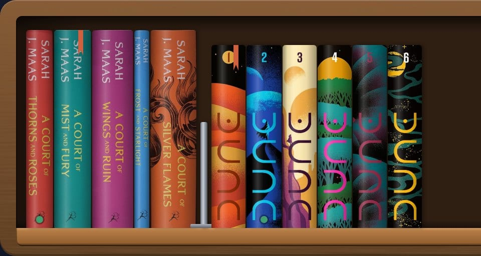</p>

---

<a id="step-4"></a>

### Step 4: Browse the library

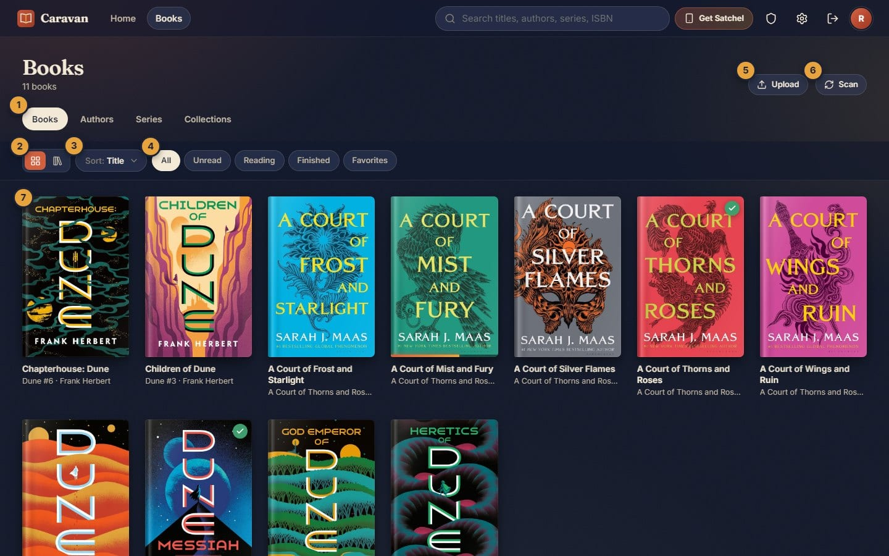

| # | Do this | To… |
|:-:|---|---|
| 1 | Switch between **Books**, **Authors**, **Series** and **Collections** | browse the library different ways |
| 2 | Choose **covers** or **bookshelf** | see a cover grid, or the wooden bookcase of spines (picture in step 3). Each device remembers your choice. |
| 3 | **Sort** | by title, author, series, date added, recently read or publication date |
| 4 | Filter: **All**, **Unread**, **Reading**, **Finished**, **Favorites** | narrow the list to your own reading state |
| 5 | **Upload** (admins) | add books from your computer straight into the library's first folder |
| 6 | **Scan** (admins) | rescan now. You rarely need this: folders are watched, and also rescanned every 6 hours. |
| 7 | **Click** a book, or **right-click / long-press** it | open it, or start selecting several books ([step 6](#step-6)) |

**Several libraries?** A **Library:** menu under the library's name switches between them. It's there on phones too, where the top tabs are hidden, and the **Library** button in the bottom bar returns to the library you used last.

On the bookshelf, series come first, A to Z, each in reading order with a bookend after it. The rest follow in your chosen sort. Books without spine pictures get a cloth spine in their cover's colour, sized by page count. A ribbon marks books you're reading, and a green dot marks finished ones.

---

### Step 5: Put the books in series

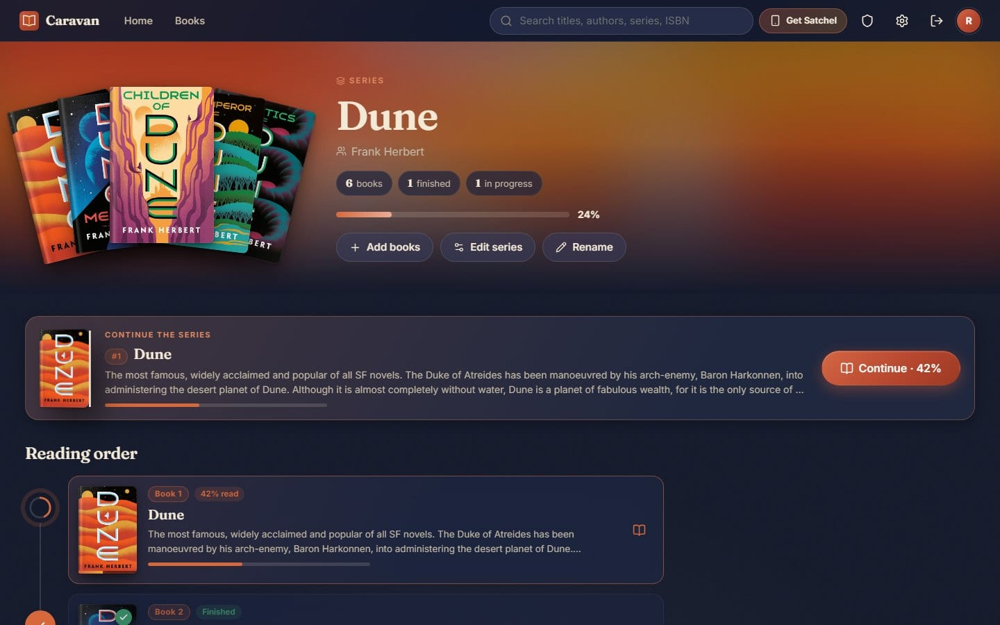

Series come from the books' own details when they have them. Otherwise, set them yourself (admins):

1. **Several books at once:** right-click or long-press a book in the library, tick the rest, and press **Add to series** ([step 6](#step-6)). Books are numbered in the order you picked them, from a starting number you choose.
2. **One book:** on its page, open **⋯ → Add to series…**.
3. **Fix numbering:** on the series page, press **Edit series** and type each book's number, or remove a book from the series. Half numbers are fine: A Court of Frost and Starlight is **3.5**. Press **Done** when finished.
4. **Rename** renames the series on every book. Renaming it to an existing series merges the two.

The series page shows how far you are, which book is next (**Continue the series**), and a **Reading order** list with a check mark on each finished book.

> [!TIP]
> Book details from the files can be untidy. One of these files called itself "A Court of Silver Flames (A Court of Thorns and Roses)". Fix titles with **⋯ → Edit metadata…** on the book's page. Your edits are never overwritten by later scans or lookups.

---

<a id="step-6"></a>

### Step 6: Collections and selecting several books

<table><tr>
<td width="50%">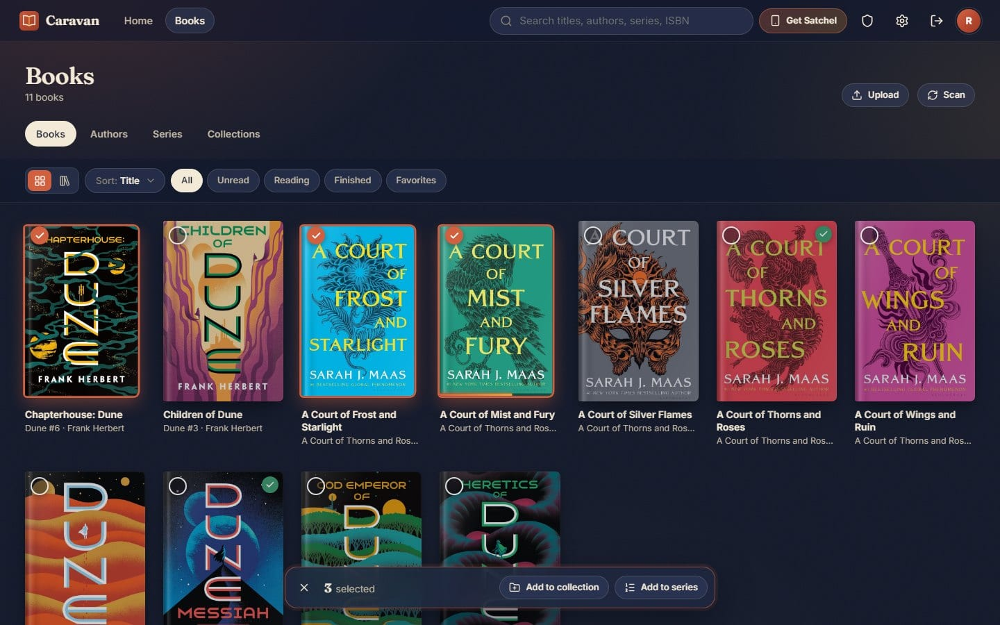</td>
<td width="50%">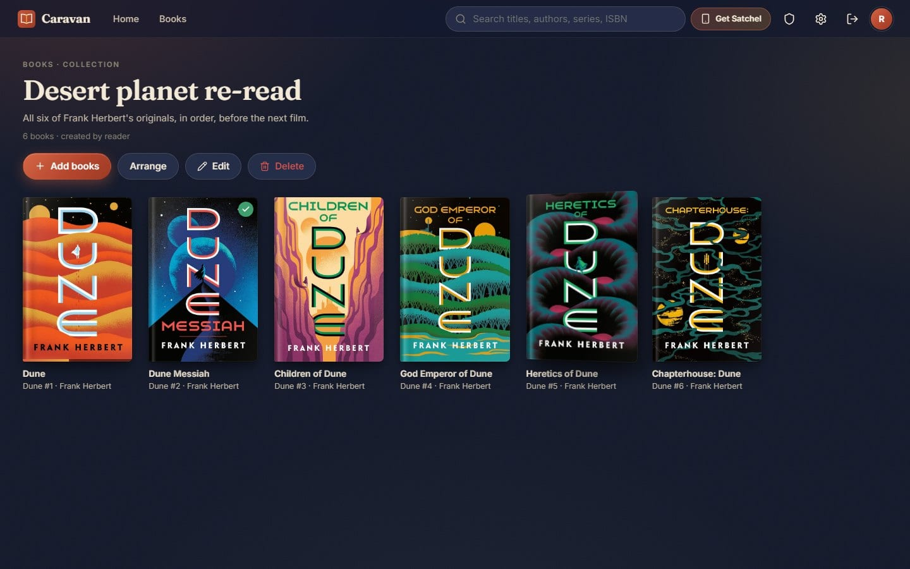</td>
</tr></table>

**Select several books:** right-click (or long-press on a phone) any book. Then tap or click more books to add them. The bar at the bottom offers **Add to collection** and **Add to series**. Press **Esc** or **✕** to stop selecting.

**Collections** are your own groups inside a library, such as a reading list, a theme, or books to lend:

1. In the library, open **Collections → New collection**, give it a name and a short description.
2. Add books from the selection bar, from **Add books** on the collection, or with the **folder +** button on any book's page.
3. **Arrange** shows arrows to move each book earlier or later, and **✕** to take it out. **Edit** renames the collection, and **Delete** removes it but not the books.

Anyone can create a collection. Only its creator or an admin can change it.

---

### Step 7: The book page

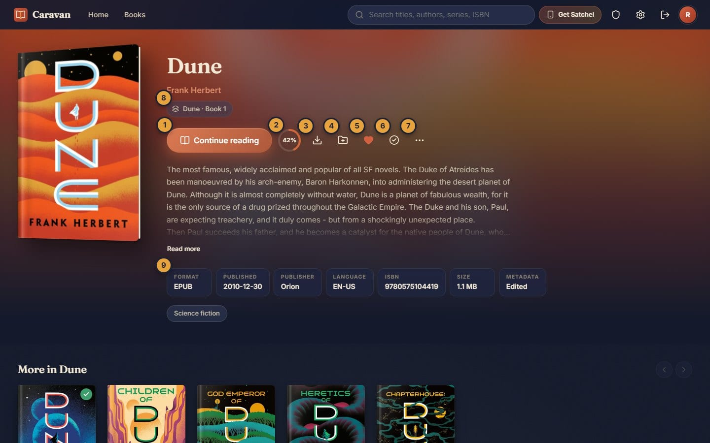

| # | What it is | What it does |
|:-:|---|---|
| 1 | **Start / Continue reading / Read again** | Opens the reader where you left off. |
| 2 | **Progress** | How far you've read. |
| 3 | **Download** | Saves the original file. If the book comes in several formats, a **Version** row appears above the description, and Read and Download use the version you pick there. |
| 4 | **Add to collection** | Tick or untick collections. |
| 5 | **Favourite** | Adds the book to your Favorites shelf. |
| 6 | **Mark finished** | Or **Mark unread**, which also resets your place. |
| 7 | **⋯ Manage** (admins) | Identify, Edit metadata, Change cover, Add to series, Refresh metadata, Remove from library. |
| 8 | **Series** | Opens the series page. |
| 9 | **Details** | Format, publication date, publisher, language, ISBN, size, and where the details came from. |

**Identify** works like Jellyfin's: search by ISBN or by title and author, compare the candidates from Open Library and Google Books side by side with their covers, and apply one.

**Several formats of one book:** files with the same name in the same folder (`Dune.epub`, `Dune.pdf`, `Dune.azw3`) are one book. EPUB is preferred for reading. Your place, bookmarks, highlights and notes follow you from one version to another ([how](#versions)).

---

### Step 8: Read

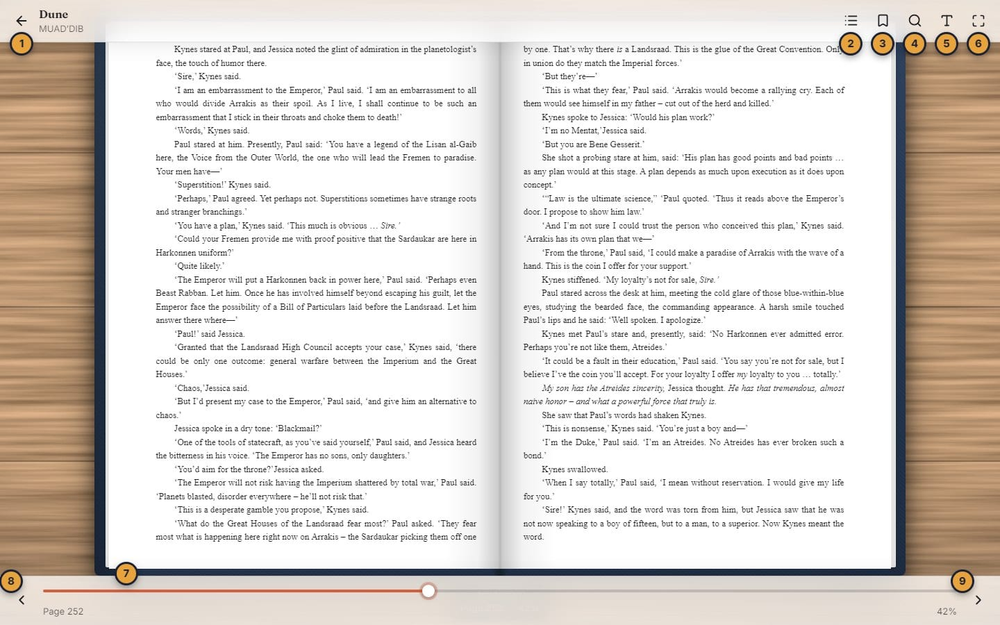

Tap the middle of the page to show or hide these controls:

| # | Control | What it does |
|:-:|---|---|
| 1 | **Back** | Leaves the reader. Your place is already saved. |
| 2 | **Contents** | **Chapters**, and **Bookmarks & highlights** with your notes. |
| 3 | **Bookmark** | Bookmarks this page. Tap again to remove it. |
| 4 | **Search** | Finds words anywhere in the book. |
| 5 | **Display** (Aa) | Theme, view, desk, page turn, font and layout (below). |
| 6 | **Full screen** | Hides the browser's own controls. |
| 7 | **Progress bar** | Drag to jump anywhere. The page number and percentage are shown underneath. |
| 8, 9 | **Previous / Next page** | Same as tapping the sides. |

**Turning pages:**

| Do this | To… |
|---|---|
| Tap the **left** or **right** third of the page | go back or forward a page |
| **Drag a corner or an edge** | lift the page and turn it yourself. The curl follows exactly where you grab it: a top corner, a bottom corner, the side edge, or pull from the top or bottom. Let go past halfway to turn it, or before halfway to let it fall back. |
| **Swipe** (phone) | turn pages |
| **← →**, **Page Up / Page Down**, **Space** | turn pages from the keyboard (**Esc** shows or hides the controls) |
| Android **back** button or gesture | closes a panel first, then leaves the reader |

Going back a page is the forward turn mirrored, so the left page lifts from its outer edge. In two-page spreads only one leaf turns, and its back shows the page that's really printed there.

**Highlights and notes:**

| 1. Select text | 2. Pick a colour | 3. Find it again |
|---|---|---|
| 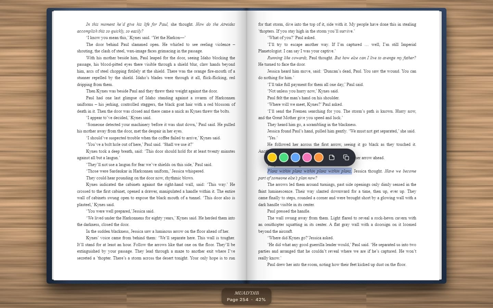 | 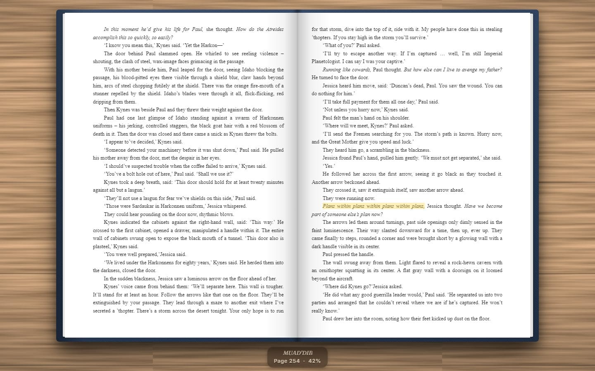 | 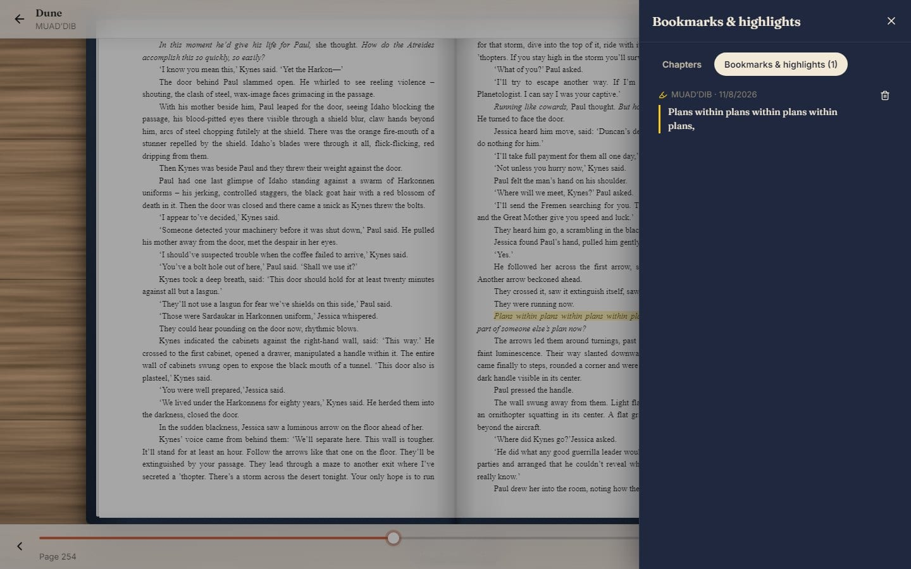 |
| Drag across the words (long-press on a phone). | Choose one of **five colours**, add a **note**, or **copy** the text. | **Contents → Bookmarks & highlights** lists them; tap one to jump there. |

**Look up a word:**

1. Select a word, or a short phrase of up to three words. On a phone, long-press it.
2. Press **Define** (the book-with-an-A button) in the popover.
3. A box shows the word from the **Merriam-Webster Collegiate® Dictionary**: syllables, part of speech, the pronunciation guide (press the speaker to hear it), and the definitions. If the word isn't in the dictionary, it suggests spellings to try.

An administrator turns this on once, with a free key: see [Set up the dictionary](#dictionary-key). Words you've looked up are remembered for 30 days, so looking them up again is instant.

**Display settings** (Aa):

<table><tr>
<td width="420">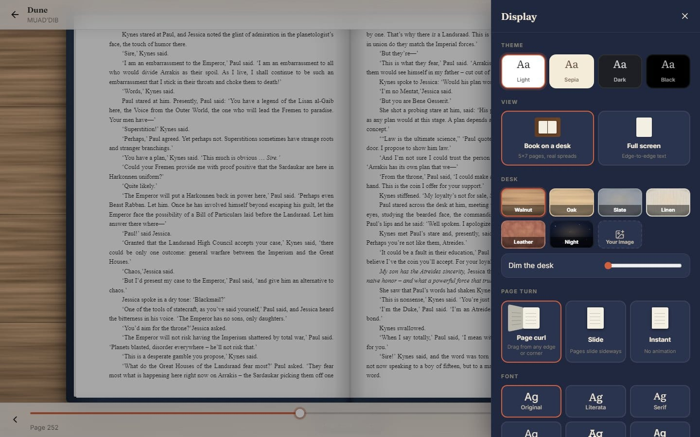</td>
<td>

- **Theme:** Light, Sepia, Dark or Black.
- **View:** **Book on a desk**, which shows 5 × 7 pages with two-page spreads on wide screens, page edges that thin as you read, and a counter on the desk below. Or **Full screen** for edge-to-edge text.
- **Desk:** Walnut, Oak, Slate, Linen, Leather, Night, or **Your image** (upload a photo), plus **Dim the desk**.
- **Page turn:** **Page curl**, **Slide** or **Instant**.
- **Font:** the book's own, Literata, Serif, Sans, Slab or Mono. Further down: size, line spacing, margins, line length, justification, hyphenation, paged or scrolling, one or two columns, brightness, and keep the screen on.

Your choices are saved per device and synced to your account. Set the defaults in **Settings → Reading defaults**.

</td></tr></table>

PDFs open with fit-to-page or fit-to-width and pinch or Ctrl+wheel zoom. Comics read page by page, with a right-to-left mode for manga.

---

### Step 9: Make it yours

<table><tr>
<td width="50%">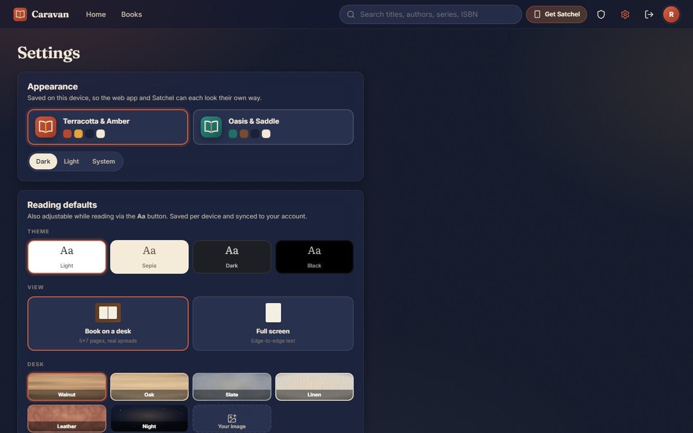</td>
<td width="50%">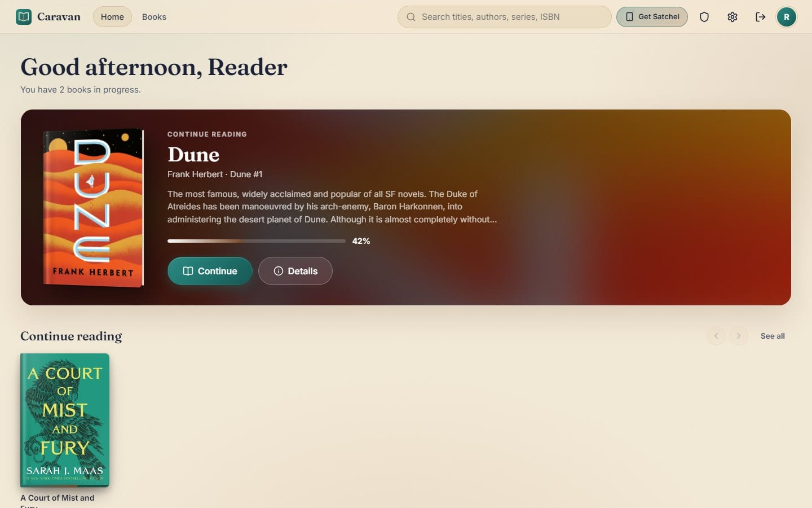</td>
</tr></table>

Open **Settings** (6):

1. **Palette:** **Terracotta & Amber** (the web app's default) or **Oasis & Saddle** (Satchel's default). Both use Night Ink, Sand and Dune as the shared base colours.
2. **Mode:** **Dark**, **Light**, or **System** to follow your device.
3. **Reading defaults:** the same choices as the reader's Display panel.

Appearance is saved per device, so your phone and your computer can each look their own way.

---

<a id="my-shelf"></a>

## My Shelf

Every account has a **My Shelf**: a private place for your own books, separate from the libraries an administrator manages.

| | |
|---|---|
| **Who sees it** | Only you. Administrators can't see, open, edit or remove books on anyone else's shelf, and they don't appear in searches, lists or counts for anyone else. |
| **Adding books** | Open **My Shelf** and press **Add books**. Choose files from your computer or phone; any [format Caravan reads](#formats) works. Covers, details, the reader, progress, highlights and the bookshelf view all work as usual. |
| **Sharing** | Open one of your books and press **Share** (next to the heart). Tick the people who may read it, or use **Everyone** or **Nobody**, then **Save**. They find it under **My Shelf → Shared with me**, with their own place and highlights. Untick someone to take it back straight away. |
| **On the book's page** | Your books say **On your shelf · only you can see it** or **…shared with 2 people**. Books shared with you say **Shared with you by …**. |
| **Removing** | **⋯ → Remove from my shelf** deletes the file. Anyone you shared it with loses access. |

The shelf has two tabs, **My books** and **Shared with me**, with the same sorting, filters and covers/bookshelf switch as a library.

> [!NOTE]
> Shelf files are stored on the server in the config folder (`/config/shelves/`). Someone with direct access to the server's disk could open them; Caravan itself never shows them to anyone but you and the people you share with.

---

<a id="satchel"></a>

## Satchel, the Android app

| Connect | Your library | Reading |
|:-:|:-:|:-:|
| 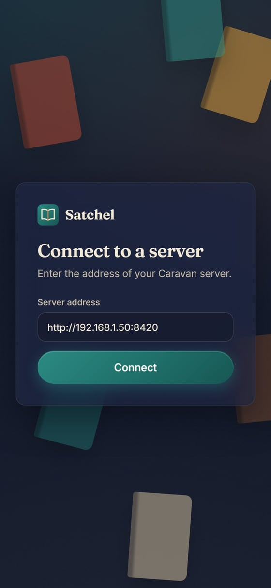 | 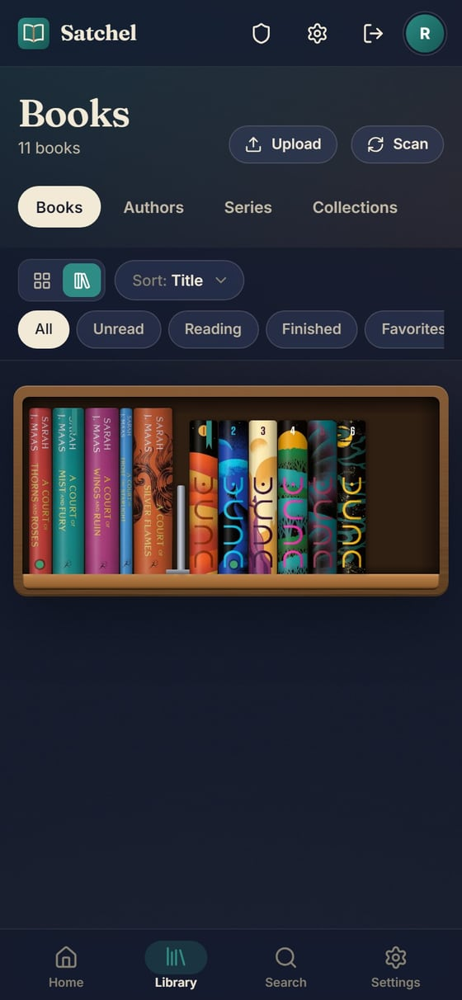 | 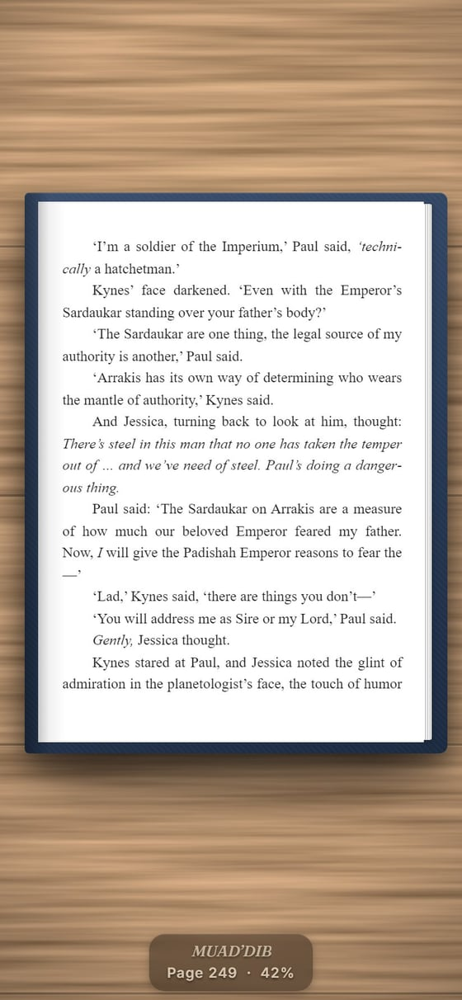 |

1. On your phone, open **[the latest Satchel release](https://github.com/GetHorizontal63/satchel/releases/latest)** and download **Satchel.apk** (or use **Get Satchel** (4) in the web app).
2. Open the file. When Android asks, allow your browser to **install unknown apps**.
3. Open Satchel and enter your server's address, for example `http://192.168.1.50:8420`. Use the same address that works in your phone's browser.
4. Sign in with your Caravan account.

Satchel shows a ribbon when a newer release is out; tap **Update** to download it. More pictures and details are in the **[Satchel README](https://github.com/GetHorizontal63/satchel)**.

<a id="offline"></a>

### Reading offline

1. On a book's page in Satchel, press the **cloud** button (where the web app has Download). It saves the version you picked on your phone, with its cover, your place and your notes. The cloud gets a tick when it's saved.
2. Without a connection, Satchel opens **On this device**, listing your saved books. Tap one to read it as usual.
3. While offline, everything you do is kept on the phone: your place, bookmarks, highlights and notes. The banner shows how many changes are waiting.
4. When the server can be reached again, Satchel goes back to normal and sends those changes on its own. It also tries when you reopen the app and every so often in the background.

**How changes merge:** new bookmarks and highlights from the phone are added to the ones made elsewhere, so nothing is lost. Deleting or editing a note on the phone applies on the server too. Your reading place from the phone only replaces the one on the server if you read on the phone more recently.

**Settings → On this device** lists saved books with their sizes, removes them, and has **Sync now**. Removing a saved copy never touches your notes or place on the server.

**Other ways to read:**

| Client | How |
|---|---|
| Any browser | Open the server address. On a phone, **Add to Home screen** installs it as a full-screen app. |
| Desktop app (Windows / macOS / Linux) | `cd desktop && npm install && npm start`, or `npm run dist` for an installer. It asks for the server address the first time. |
| OPDS apps (KOReader, Moon+ Reader, Librera…) | Add the catalogue `http://<server>:8420/opds` and sign in with your Caravan account. Books in several formats offer each one. |

---

<a id="troubleshooting"></a>

## Troubleshooting

Find your symptom below and follow the steps in order.

<a id="ts-connect"></a>

### 1. Satchel or the browser can't reach the server

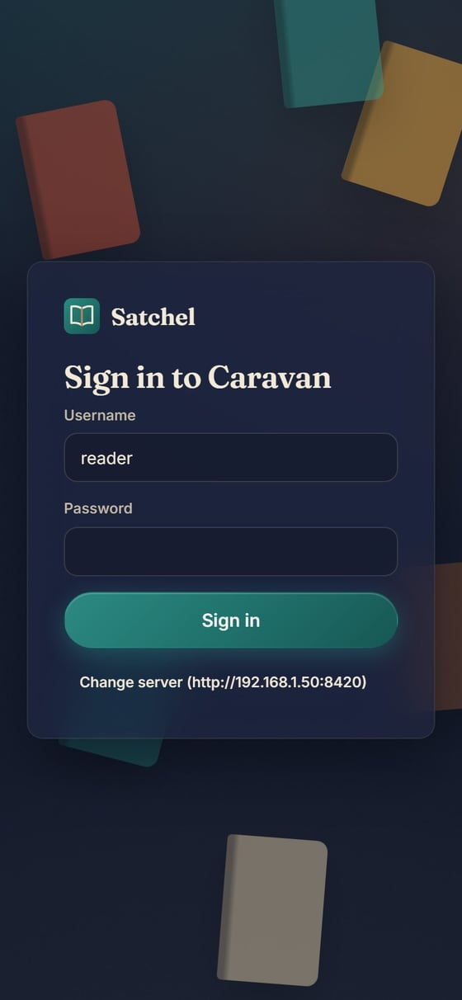

1. **Use the server's own address.** That's the IP you use to open TrueNAS (for example `192.168.1.50`) with `:8420` after it. Addresses like `172.16.x.x` in the container's log are internal to Docker and can't be reached from anything else.
2. **Test in the phone's browser first:** open `http://<address>:8420`.
   - **`ERR_ADDRESS_UNREACHABLE`:** the phone has no route to the server. Check that it's on your home Wi-Fi, not mobile data or a guest network. If you connect through **Tailscale** or another VPN, make sure it's switched on and that Satchel isn't excluded from it (Tailscale → **Settings → Split tunneling**).
   - **`ERR_CONNECTION_REFUSED` or a timeout:** the address is right but nothing answers on port 8420. In the TrueNAS shell, `sudo docker ps` should show `0.0.0.0:8420->8420/tcp`.
3. **Browser works, Satchel doesn't:** in Satchel, press **Change server** and type the exact address that worked in the browser, numbers rather than a name. The message under the box says what went wrong: a timeout, a refused connection, or a server that isn't Caravan.

<a id="ts-name"></a>

### 2. The TrueNAS app won't start: "container name "/caravan" is already in use"

**Cause:** a second copy of Caravan was started outside the TrueNAS app (for example with `docker compose` in the shell), and it holds the name.

1. In the TrueNAS shell, run:
   ```sh
   sudo docker rm -f caravan
   ```
   Your library and settings are safe; they live in the config folder, not in the container.
2. Make sure the app's YAML has **no** `container_name:` line (the one in [Quick start](#quick-start) doesn't).
3. In **Apps → caravan**, press **Edit → Save** (or **Start**).
4. From now on, update only through **Edit → Save**. If you ever need the shell, the project name is `-p ix-caravan`.

### 3. The `covers/` and `spines/` folders never appear

**Cause:** Caravan isn't allowed to write in your book folders.

1. Check the books mount doesn't end in `:ro`.
2. Give the user Caravan runs as (`568` on TrueNAS) **write** permission on the books dataset (**Datasets → Edit Permissions**).
3. Or create the folders yourself. Caravan only needs to **read** them.

### 4. A new book, cover or spine doesn't show up

1. Wait about **15 seconds** after the copy finishes, then refresh the page.
2. Still missing? Press **Scan** on the library page.
3. Check the file type is supported ([formats](#formats)). Files in hidden folders, `@eaDir`, `#recycle` and `$RECYCLE.BIN` are skipped.
4. Folder watching can't see changes made over some network mounts inside a container. The automatic scan every 6 hours (**Administration → Metadata & server**) catches them.

### 5. The wrong cover or spine is used

1. A picture **beside the book** (`cover.jpg`, `Dune.cover.jpg`) beats anything in `covers/` or `spines/`. Rename or remove it if you want the folder picture.
2. In a folder with **several books**, pictures must be named after the book (`Dune.jpg` for `Dune.epub`). A plain `cover.jpg` there is ignored, because Caravan can't tell which book it's for.
3. A cover chosen with **⋯ → Change cover…** stays until you change the picture file in the folder.
4. See the [full priority order](#art-rules).

### 6. Book details are wrong or missing

1. On the book's page, press **⋯ → Identify…** and search by ISBN, or by title and author. Pick the right match.
2. **⋯ → Edit metadata…** fixes anything by hand. Switch on **Lock metadata** to stop automatic lookups and rescans from changing it.
3. For better matching, add a free **Google Books API key** in **Administration → Metadata & server**. Without one, Google's shared anonymous quota is usually used up, and matching falls back to Open Library alone.

### 7. Which version is running?

In the TrueNAS shell:

```sh
sudo docker image inspect caravan:latest --format 'Image built: {{.Created}}'   # when the running image was built (UTC)
git ls-remote https://github.com/GetHorizontal63/caravan.git main               # the newest commit on GitHub
```

If the image is older than your last push, open **Apps → caravan → Edit → Save** to rebuild.

### 8. "Define" says the dictionary isn't set up

1. An administrator opens **Administration → Metadata & server**.
2. Paste a Merriam-Webster key into **Merriam-Webster dictionary key** and press **Save** ([how to get one](#dictionary-key)).
3. If it says Merriam-Webster **refused** the key, check that it's a **Collegiate Dictionary** key; keys for the other dictionaries don't work here.

### 9. Notes made offline haven't appeared on the server

1. Open Satchel while connected. Changes are sent automatically when the app opens and when the connection returns.
2. In **Settings → On this device**, press **Sync now**. The line above it says how many changes are still waiting.
3. If the count doesn't go down, Satchel still can't reach the server; see [problem 1](#ts-connect).

> [!NOTE]
> Still stuck? Open the app's **Logs** in TrueNAS (or `docker logs`) and include the last few lines when you ask for help. Book links in the logs no longer include your sign-in token, so they're safe to share.

---

<a id="reference"></a>

## Reference

<a id="formats"></a>

### Supported formats

| Format | Opens as | Notes |
|---|---|---|
| EPUB 2/3, Kobo EPUB (`.kepub.epub`) | reflowable book | read natively |
| MOBI, PRC, AZW, AZW3 / KF8 | reflowable book | read natively; DRM-free only |
| FB2, FBZ (`.fb2.zip`) | reflowable book | read natively |
| PDF | fixed pages | fit to page or width, zoom; highlights aren't available in PDFs |
| CBZ | comic | page by page; right-to-left mode |
| CBR | comic | converted to CBZ the first time it's opened, then cached |
| TXT, Markdown, HTML | reflowable book | converted to EPUB the first time, with chapters found from headings |
| DOCX, ODT, RTF, LIT, PDB, LRF | reflowable book | need Calibre (`INSTALL_CALIBRE=true` in Docker, or `CARAVAN_CALIBRE_CONVERT`) |

When the same book is in several formats, they're listed best first: EPUB, AZW3, MOBI, AZW, FB2, FBZ, CBZ, CBR, PDF, then the converted formats.

<a id="art-rules"></a>

### Where covers and spines come from

From highest priority to lowest:

1. **A picture beside the book:** `<book name>.cover.jpg`, `<book name> - cover.png` or `<book name>_spine.webp` in any folder; or `cover.*` / `spine.*` when the folder holds only that book.
2. **The `covers/` or `spines/` folder:** a picture named like the book file (exact, or a shorter name that fits only one book). When the folder holds a single book, any picture works, preferring `cover.*`, `front.*` or `folder.*` (covers) and `spine.*` (spines).
3. **A cover you chose** with **Change cover…** or **Identify** (covers only).
4. **The cover inside the file**, or a Calibre `cover.jpg` next to a `metadata.opf`.
5. **A downloaded cover** from Open Library or Google Books (when **Fetch metadata online** is on).
6. Otherwise: for covers, a coloured placeholder with the title; for spines, a generated cloth spine in the cover's main colour.

Pictures in folders are re-read whenever the file changes. Removing a spine picture returns the book to a generated spine.

<a id="versions"></a>

### One book, several formats

- Files with the **same name in the same folder** are one book. Removing one file keeps the book while any version is left.
- **Reading position:** each format counts pages differently, so opening another version takes you to the same point in the book by percentage.
- **Highlights** made in one version are found in the others by searching for their text near where they were. This works exactly between EPUB, MOBI, AZW3, FB2 and converted text. In PDFs, highlights appear in the notes list marked *approx.*, and tapping one jumps to about the right page.
- The notes list marks highlights made in another version with that version's format.

<a id="dictionary-key"></a>

### Set up the dictionary

1. Go to **[dictionaryapi.com](https://dictionaryapi.com)** and register (free).
2. Request a key for the **Merriam-Webster's Collegiate® Dictionary with Audio**.
3. In Caravan, open **Administration → Metadata & server**, paste it into **Merriam-Webster dictionary key**, and press **Save**.

The key stays on the server; browsers and phones never see it. The free key allows 1,000 look-ups a day, and Caravan remembers each word for 30 days, so repeated look-ups don't count.

### Configuration

| Variable | Default | What it does |
|---|---|---|
| `CARAVAN_PORT` | `8420` | HTTP port |
| `CARAVAN_HOST` | `0.0.0.0` | Address to listen on |
| `CARAVAN_DATA_DIR` | `./data` (`/config` in Docker) | Database and caches |
| `CARAVAN_WEB_DIR` | `./web/dist` | The built web client |
| `CARAVAN_CALIBRE_CONVERT` | – | Path to Calibre's `ebook-convert`; enables DOCX, ODT, RTF, LIT, PDB and LRF |
| `CARAVAN_SCAN_ON_START` | `1` | `0` skips the scan at startup |
| `CARAVAN_WATCH` | `1` | `0` stops watching library folders (scheduled and manual scans only) |
| `CARAVAN_LOG_LEVEL` | `info` | `debug`, `info`, `warn` or `error` |

The older `JR_*` names still work. More settings live in **Administration → Metadata & server**: server name, provider order, automatic matching, the rescan interval (default every 6 hours), the Google Books API key, and the Merriam-Webster dictionary key.

### How books are matched

1. Read the details inside the file, then a Calibre `metadata.opf` if there is one, then the file name (`Author - Title (Year).ext`).
2. Find an ISBN in those details, on the copyright pages (EPUB and PDF text), or in the file name. Check its checksum and convert it to ISBN-13.
3. **With an ISBN:** look it up on every provider and merge the results. The first provider in your order wins; the others fill gaps.
4. **Without one:** search by title and author, and accept a result only when the title and surname match closely (score ≥ 0.8).
5. Empty fields are filled in, but nothing you've set is overwritten unless you use **Identify** or **Edit metadata**. Locked books are never touched.

### Known limits

- DRM-protected books can't be opened. Remove DRM with tools you're entitled to use, or buy DRM-free.
- PDFs can't show highlights (bookmarks work), and **Define** needs selectable text, so it doesn't work in PDFs or comics.
- Offline reading is for Satchel. In a browser, the page itself needs the server to load.
- Comic libraries have no spine pictures; the bookcase uses generated spines for them.
- Folder watching depends on the system's change notifications. Some network mounts don't provide them, so the scheduled scan covers those.

<details>
<summary><b>How it works</b> (for the curious and for developers)</summary>

#### The pieces

```
┌──────────── clients ────────────┐        ┌──────────────── server (Node 24) ────────────────┐
│ Web / PWA (React)               │  HTTP  │ Fastify REST API  ·  OPDS 1.2 catalogue           │
│ Satchel (Android, Capacitor)    │ ─────▶ │ Scanner + folder watcher → format extractors      │
│ Desktop (Electron shell)        │        │   (EPUB, MOBI, AZW3, FB2, PDF, CBZ/CBR, Calibre)   │
│ KOReader / Moon+ / … (OPDS)     │        │ Metadata: ISBN → Open Library / Google Books      │
└─────────────────────────────────┘        │ Converters: CBR→CBZ, TXT/MD/HTML→EPUB, Calibre    │
                                           │ SQLite (node:sqlite) · covers & spines (sharp)    │
                                           └───────────────────────────────────────────────────┘
```

- **Reading happens in the browser.** foliate-js renders EPUB, MOBI, AZW3, FB2 and CBZ, and pdf.js renders PDF, so every client reads the same way.
- **The page curl** is built from the fold line between where you grabbed and where your finger is. The leaf's back is a live copy of the next page, reflected twice. Going back uses a mirrored frame instead of playing the forward turn in reverse.
- **Scanning** groups files by folder and name into books, reads metadata from the preferred format, applies folder art, and queues identification for new books. A recursive folder watcher triggers a rescan of just that library after 15 quiet seconds.
- **Versions:** each book has one row per file (`book_files`). Progress and annotations remember which file they were made in. Highlights are re-found in other formats by text search, and the result is cached per file (`annotation_anchors`).

#### Files

```
server/src/          API (routes/), scanner + watcher, folder art, converters, metadata providers, SQLite schema (db.ts)
server/src/extract/  per-format metadata readers (EPUB/OPF, MOBI/EXTH, FB2, PDF, comics)
web/src/             pages, components, theme; reader/ holds the engines (foliate, pdf.js), page curl and reader UI
mobile/              Satchel: Capacitor 8 Android project (android/) and its README template
desktop/             Electron shell
docs/img/            pictures used in this README
scripts/windows/     start-up task and launcher for Windows
```

#### Develop

```bash
npm run dev:server     # API on :8420 (node --watch, runs TypeScript directly)
npm run dev:web        # Vite on :5173, proxies /api and /opds to :8420
npm run typecheck
```

#### Build Satchel

The Android project is in `mobile/android` (Capacitor 8; Android 7 / API 24 or newer; targets API 36). Build from a **local drive**.

```bash
npm run build --prefix web             # 1. build the web client
cd mobile && npm install
npm run sync                           # 2. copy web/dist into the app and wire up plugins
cd android
echo sdk.dir=C\:/Users/<you>/AppData/Local/Android/Sdk > local.properties
set JAVA_HOME=C:\Program Files\Android\Android Studio\jbr
gradlew assembleDebug                  # 3. android/app/build/outputs/apk/debug/app-debug.apk
```

Releases are published to the [Satchel repository](https://github.com/GetHorizontal63/satchel/releases) together with each Caravan push.
</details>

<p align="center"><sub>Caravan · Satchel · made for reading at home</sub></p>
